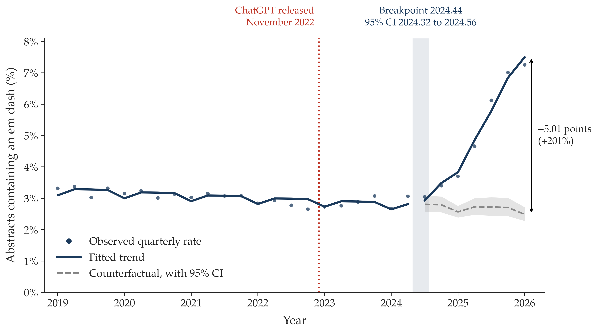

# Em dash prevalence in scientific abstracts

Code and aggregate data for *From indicator to stereotype: the life cycle of the em dash in 600,000 scientific abstracts*, aligned with the 8 October 2026 manuscript for AI & Society.

The study covers 615,299 Scopus abstracts from 487 journals, 2019 to June 2026.



## Reproduce

Use Python 3.12 and R with `dplyr`, `segmented`, `sandwich`, and `lmtest`.

```bash
uv sync --locked
Rscript -e 'install.packages(c("dplyr", "segmented", "sandwich", "lmtest"), repos="https://cloud.r-project.org")'
uv run python scripts/02_analyze.py
Rscript scripts/03_models.R
uv run python scripts/04_figures.py
```

These commands reproduce the analyses and Figures 1–8. To redraw the figures alone, run the last command. Figure 1 uses the text and coordinates in its plotting script; the other figures use the included counts.

- `data/`: journal list, annual and quarterly counts, manual-validation counts.
- `scripts/`: preparation, analysis, models, and plotting code.
- `results/`: statistical tables and figure source data.
- `figures/`: manuscript figures.

See [data/README.md](data/README.md) for count definitions and input preparation. Python versions are locked in `uv.lock`; R versions are recorded in [results/time_series/session.txt](results/time_series/session.txt).

## Rebuild the counts

With the original Scopus exports and source list:

```bash
cp .env.example .env
# Set DATASET_PATH and SOURCE_LIST_PATH in .env.
uv run python scripts/01_prepare.py
```

Then run steps 02–04 above. Raw exports and article-level files stay in ignored local folders.

Run the checks with `PYTHONPATH=scripts uv run python -m unittest discover -s tests`.
